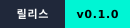
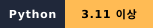
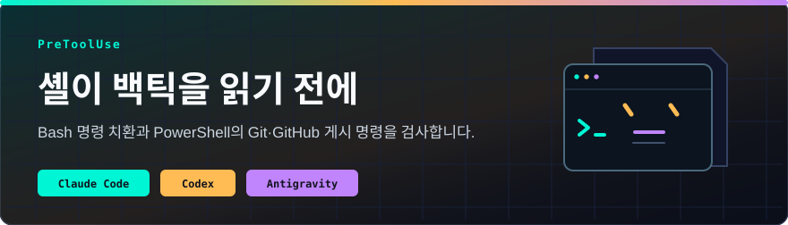
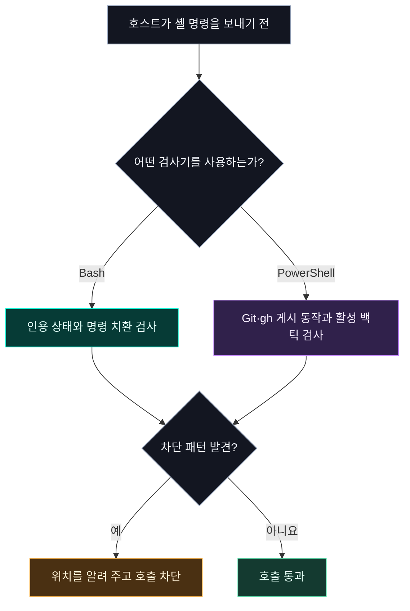
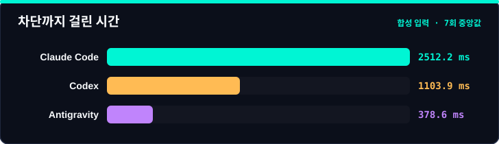

# 백틱 검사 훅

<div align="center">
  <a href="https://github.com/Technoetic/backtick-check-hook/releases/tag/v0.2.0"></a>
  <a href="#install-and-check"></a>
  <a href="LICENSE"></a>
</div>



셸로 릴리스 노트를 작성하면 마크다운에 쓴 코드 이름이 사라질 수 있습니다. Bash는 큰따옴표 안에서도 백틱 사이의 글을 **명령으로 실행**하고, PowerShell은 백틱과 다음 글자를 **이스케이프 시퀀스로 해석**합니다. 이 훅은 Claude Code·Codex·Antigravity가 셸을 호출할 때 명령을 미리 읽고, 원문을 바꿀 수 있는 패턴을 발견하면 차단 위치를 알려 줍니다.

[설치](#install-and-check) · [내 대화에서 확인](#probe-your-host) · [한국어 상세 안내](README.ko.md) · [English guide](README.en.md)

## 🔎 어떤 명령을 검사하나요?

| 셸 | 차단하는 예 | 통과하는 예 |
|---|---|---|
| **Bash** | 큰따옴표 안에서 백틱으로 명령을 치환하는 경우 | 작은따옴표로 감싸 백틱을 글자 그대로 출력하는 경우 |
| **PowerShell** | `gh release create --notes`처럼 게시 본문을 인라인·참조 변수·파일/파이프로 넘길 때 활성 백틱이 있는 경우 | `Write-Output`만 호출하거나, `--amend --no-edit`·작은따옴표 게시와 분리된 문장의 탭·CR 이스케이프 |



> [!TIP]
> 릴리스 노트나 커밋 메시지에 마크다운 예시가 많다면 본문을 파일에 쓰세요. GitHub CLI에는 `--notes-file`이나 `--body-file`로, Git에는 `git commit -F`로 파일을 넘길 수 있습니다.

<a name="install-and-check"></a>

## 🚀 설치와 확인

[릴리스 ZIP](https://github.com/Technoetic/backtick-check-hook/releases/download/v0.2.0/backtick-check-hook-0.2.0.zip)을 풀고 `install.py`가 있는 폴더에서 시작하세요. 다음은 **Windows에서 Codex**에 설치하는 예입니다.

```powershell
python -I -X utf8 -B install.py install --host codex
python -I -X utf8 -B install.py doctor --host codex
```

> [!IMPORTANT]
> 설치에는 **Python 3.11 이상**이 필요합니다. Windows에서 **Claude Code**를 쓸 때는 **Git Bash**도 필요합니다. POSIX에서는 위 명령의 `python`을 `python3`로 바꾸세요.

| 사용할 호스트 | `--host` 값 | 설치한 뒤 |
|---|---|---|
| Claude Code | `claude` | 사용자 설치와 네이티브 플러그인 중 하나를 선택하고 새 대화에서 확인합니다. |
| Codex | `codex` | 실행 중인 CLI의 <kbd>/hooks</kbd> 또는 데스크톱 앱의 **Review hooks**에서 선언을 신뢰합니다. 새 대화와 거기서 만든 하위 대화에서 확인합니다. |
| Antigravity | `antigravity` | 새 대화에서 확인합니다. 기존 대화에도 적용하려면 허브를 다시 시작합니다. |

Codex와 Antigravity의 설치형 훅은 Windows에서 PowerShell 검사기, POSIX에서 Bash 검사기를 사용합니다. Claude Code는 호출된 도구에 따라 검사기를 선택합니다.

> [!CAUTION]
> 훅은 사용자 권한으로 실행됩니다. 다른 사람이 수정할 수 있는 프로젝트 폴더 밖에 신뢰할 수 있는 사본을 두세요. 설정 파일의 서식까지 복원해야 한다면 설치 전에 사본을 보관하세요. [보안과 신뢰](SECURITY.md)

<a name="probe-your-host"></a>

## 🧪 내 대화에서 확인하기

`doctor`는 설치 파일·등록·합성 이벤트를 확인합니다. 실제 대화에서는 호스트가 쓰는 셸에 맞춰 **한 줄씩 별도 호출**로 보내세요. 두 예시 모두 첫 줄은 거짓 분기여서 본문의 명령이 실행되지 않습니다.

**PowerShell** · Windows용 Codex·Antigravity 또는 Claude Code의 PowerShell 도구

```powershell
if ($false) { gh release create v0.0.0-probe --notes "probe `x` text" }
Write-Output "a`tb"
echo plain
```

정상이라면 첫 줄은 `[backtick-check-hook]`과 위치 **1:61, 1:63**을 표시하며 차단돼야 합니다. 둘째 줄은 `a`와 `b` 사이에 탭 하나를, 셋째 줄은 `plain`을 출력해야 합니다.

<details>
<summary><strong>Bash에서 보낼 세 줄</strong> · Claude Code의 Bash·Monitor 또는 POSIX용 Codex·Antigravity</summary>

```bash
if false; then echo "probe `x` text"; fi
echo 'literal `x`'
echo plain
```

정상이라면 첫 줄은 같은 표지와 함께 차단돼야 합니다. 둘째 줄은 백틱 두 개를 포함한 원문을, 셋째 줄은 `plain`을 출력해야 합니다.

</details>

<a name="limits-and-false-positives"></a>

> [!WARNING]
> PowerShell 인라인 게시는 해당 게시 문장과 참조 변수·하위식 흐름만 검사하지만, 파일·표준 입력·파이프(`-F`, `--notes-file`, `--body-file`, `--input`, 앞쪽 `|`)나 간접 실행·스플래팅·미종결 구문은 **호출 전체** 규칙을 유지합니다. 훅이 미신뢰 상태이거나 검사 시간이 초과되면 명령이 검사 없이 실행될 수 있습니다. [검사 범위와 오탐](README.ko.md#남는-틈과-과잉-차단)

<a name="live-host-measurements"></a>
<a name="python-version-and-local-launcher-timings"></a>

## 📊 v0.2.0 검증 결과

Windows CI는 Python 3.11~3.15와 콘솔 코드 페이지 949·65001을 조합합니다. 한 조합에서 130건씩, 총 $5 \times 2 \times 130 = 1{,}300$건을 실행하고 Ubuntu 작업에서 결정론적 ZIP 재현성과 SHA-256을 확인합니다. [Check 워크플로 실행 기록](https://github.com/Technoetic/backtick-check-hook/actions/workflows/check.yml)

<details open>
<summary><strong>훅이 호출되는 과정과 Windows에서 측정한 응답 시간</strong></summary>

| 셸 명령 한 건의 흐름 | 차단 응답 시간 |
|:---:|:---:|
| <picture><source media="(prefers-reduced-motion: reduce)" srcset="docs/art/flow.png"></picture> | [](docs/art/timing.svg) |
| 시연용 예시. 이동 속도는 측정값과 무관합니다. | 설치된 훅에 합성 입력을 보낸 뒤 응답까지 측정한 값입니다. |

</details>

> [!NOTE]
> 시간 차트는 Windows에서 한 번 예열한 뒤 7회 측정한 중앙값입니다. **0.2.0을 설치한 세 호스트의 실제 대화와 체감 지연은 미시험**입니다. [측정 환경과 평문·차단 시간표](README.ko.md#python-버전과-로컬-실행-시간)

<a name="remove-troubleshoot-and-test"></a>

## 🧰 제거와 문제 해결

Codex에 등록한 훅을 제거하려면 설치에 사용한 패키지 폴더에서 다음 명령을 실행하세요. 다른 호스트를 선택했다면 `codex` 자리에 그 호스트 값을 넣습니다.

```powershell
python -I -X utf8 -B install.py uninstall --host codex
```

등록을 수동으로 편집했거나 제거 중 충돌이 난 경우에는 설치 기록에서 해당 처리기를 확인하세요. [복원 절차와 로컬 시험](README.ko.md#제거문제-해결시험) · [변경 기록](CHANGELOG.md)

<details>
<summary><strong>코드에서 검사기와 시험 찾기</strong></summary>

<!-- md-viz:start:repo-tree -->
```text
backtick-check-hook/  ← 패키지 루트
├── .claude-plugin/   ← Claude Code 플러그인 선언
├── .github/          ← Windows 시험과 ZIP 재현성 검사
├── hooks/            ← Claude Code 훅 선언과 셸 실행기
├── scripts/          ← Bash·PowerShell 검사기와 호스트 어댑터
├── tests/            ← 판정·설치·호스트 호출 회귀 시험
├── tools/            ← Windows 코드 페이지별 시험 실행기
└── install.py        ← 호스트별 설치·진단·제거
```
<!-- md-viz:end:repo-tree -->

</details>
